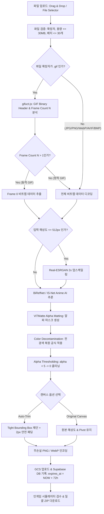

### 업무용 프로그램 개발 Design Doc (v2.0)
"BizApp Design Doc v2.0 (Universal AI Background Removal & Image Converter Design Document v2.0)"

#### ***작성 기준: removebg / SpriteCut AI Studio v2.0 (Next.js 15 + React 19 + Electron + Python FastAPI + BiRefNet + Sharp + Supabase + GCP Cloud Run)***

###### **0. 이 문서의 사용법**
###### 0.1 문서의 역할과 목적
| 문서 | 무엇을 정하나 | 주요 대상 |
| --- | --- | --- |
| BizApp Detailed App Development Plan v2.0 | **전체 시스템 세부 규격** : 프로젝트 목표, 아키텍처, 3개 프레임 UX, 공통 정책, 72시간 TTL, i18n, 배포 파이프라인 | 표준 기획 문서 |
| **이 Design Doc (v2.0)** | **SpriteCut AI Studio만의 세부 구현 설계 및 코드 명세** : 12단계 AI 누끼 파이프라인, Color Decontamination 수학 공식, GIF 판별 알고리즘, Supabase Schema, GCP Cloud Run Docker, Cursor Prompt | AI 코딩 Agent (Cursor) & 개발자 |

###### 0.2 작성 및 코딩 규칙
* 수치는 **숫자로 명확하게** 기재한다 (예: "1회 최대 30개 파일", "25MB 용량 제한", "72시간 자동 파기", "2px 패딩").
* 프로그램 데이터의 **모든 ID, 변수명, 함수명, 파일명, DB 컬렉션/테이블/필드, API 경로, 이벤트 코드는 100% 영문(English)**으로 작성한다.
* 화면에 표시되는 사용자 UX 텍스트는 **한국어(Default), English, Japanese** 3개 언어 스위처 사전으로 구성한다.
* AI 에이전트(Cursor)는 이 문서의 수치와 아키텍처 명세를 1:1로 코드로 구현한다.

---

###### **1. 프로그램 개요 (Program Overview)**
| 항목 | 내용 상세 |
| --- | --- |
| **프로그램명** | removebg / SpriteCut AI Studio (로고: SpriteCut AI) |
| **영문 ID** | removebg / spritecut-ai-studio |
| **한 줄 소개** | 게임 캐릭터, 털, 나뭇가지까지 섬세하게 추출하는 초고정밀 AI 배경 제거 및 투명 에셋 변환 도구 |
| **핵심 재미/가치** | 1. 다양한 이미지(.jpg, .jpeg, .png, .webp, .avif, .bmp, .gif) 업로드 및 스마트 배경 투명화<br>2. GIF 1프레임/애니메이션 자동 분석 및 첫 프레임(Frame 0) 정적 투명 변환<br>3. Auto-Trim (여백 재단 + 2px 패딩) vs Original Canvas (원본 규격/피벗 유지) 선택 기능<br>4. 머리카락, 털, 가지 선화 손실 없는 12단계 AI & 수학적 전경색 복원(Color Decontamination)<br>5. 오프라인 데스크톱(Electron + Local GPU) 및 웹/모바일 SaaS(Supabase + GCP Cloud Run GPU) 양방향 지원<br>6. 72시간 후 원본 및 변환 파일 스토리지/DB 자동 영구 파기(TTL)로 저작권 및 보안 보장 |
| **타겟 사용자** | 미니게임 개발자, 2D/3D 게임 아티스트, 그래픽 디자이너, AI 생성(Flux) 자산 편집자 |
| **플랫폼** | Desktop Offline App (.exe / .dmg) & Responsive Web / PWA |
| **핵심 기술 스택** | **Next.js 15+ (React 19) + Tailwind CSS v4 + Framer Motion + Sharp + Python FastAPI Sidecar + PyTorch (BiRefNet) + Supabase + GCP Cloud Run GPU + GCS** |
| **개발 에이전트** | **Cursor (AI-Native IDE / Composer Agent)** |

---

###### **2. 핵심 변환 루프 및 특수 판별 로직 (Core Loop Flowchart)**



---

###### **3. 화면 흐름 및 반응형 UX 레이아웃**

###### **3.1 메인 UX 화면 흐름**
1. **Intro Screen (/intro)**: 6초 '케데헌' 스타일 애니메이션 비디오 자동 재생 (Skip 및 Sound 토글 제공).
2. **Login Selection Screen (/auth)**: 5가지 인증 옵션 ([Google 로그인], [이메일 로그인], [휴대폰 로그인], [회원가입], [계정 없이 사용(Guest)]).
3. **Main Converter Screen (/)**: **[배경 제거 (Remove Background)] 탭 최우선 기본 활성화**.
4. **Interactive Preview & Touch-Up Screen**: 인게임 배경 시뮬레이터 및 캔버스 수동 보정 브러시.
5. **Export Screen**: 일괄 ZIP 다운로드 및 72시간 파기 카운트다운 타이머.

###### **3.2 반응형 3개 프레임 레이아웃 규격**
| 프레임 구분 | 뷰포트 조건 | 레이아웃 구성 | UX 요소 및 동작 |
| --- | --- | --- | --- |
| **Desktop** | $w \ge 1024\text{ px}$ | **Left Sidebar (280px) + Center Workspace + Right Queue** | • 좌측 사이드바: 캔버스 옵션(Auto-Trim/Original), AI 정밀도 선택, i18n 언어 스위처<br>• 중앙: DropZone, 실시간 캔버스 시뮬레이터, 브러시 터치업<br>• 우측: 배치 작업 큐 및 72h TTL 타이머 |
| **Mobile Portrait** | $w < 1024\text{ px}$ & Portrait | **Top Header + Bottom Navigation Bar (64px)** | • 상단: SpriteCut AI 로고 + 퀵 토글<br>• 하단: [변환] [시뮬레이터] [큐/다운로드]<br>• 터치 친화적 DropZone |
| **Mobile Landscape** | $w < 1024\text{ px}$ & Landscape | **Top Header (Compact 48px) + Bottom Navigation Bar (56px)** | • 수평 공간 최적화 2열 그리드 레이아웃 |

---

###### **4. AI 이미지 배경 제거 & 후처리 파이프라인 세부 스펙**

###### **4.1 6단계 JPG/PNG 정밀 후처리 파이프라인 코드 알고리즘**

1. **사전 가이드 업스케일링 (Guided Super-Resolution)**:
   * 이미지 해상도가 $512 \times 512$ 이하일 경우, Real-ESRGAN으로 $2\text{x}$ 업스케일하여 알파 마스크 추출 후 리샘플링하여 SSAA 안티앨리어싱 확보.

2. **코어 AI 세그멘테이션 라우팅**:
   * 일반/실사/캐릭터: **BiRefNet** 또는 **BRIA RMBG 2.0**
   * 2D 일러스트/도트/아니메: **IS-Net (Anime-Seg)** (캐릭터 안쪽 내공 타공 보존)

3. **정밀 알파 매팅 (Alpha Matting)**:
   * AI 마스크 경계 주변 $10\text{ px}$ 영역을 Trimap(Foreground, Background, Unknown)으로 설정하고 **ViTMatte** 알고리즘 적용.

4. **수학적 전경색 복원 (Color Decontamination / Defringing) ★ 핵심**:
   * 픽셀 침식(Erosion) 없이, 경계 픽셀 $I$에 잔존하는 배경색 $B$ 성분을 제거하여 머리카락, 털, 나뭇가지, 활시위 선화를 100% 보존.
   * **공식**:
     $$F_{\text{clean}} = \text{clip}\left( \frac{I - (1 - \alpha)B}{\max(\alpha, \epsilon)}, 0, 255 \right)$$

5. **알파 클리닝 (Alpha Thresholding)**:
   * $\alpha < 5$ 유령 픽셀은 $\alpha = 0$, $\text{RGB} = (0,0,0)$으로 완전 초기화.

6. **규격 재단 (Auto-Trim & Padding)**:
   * **Auto-Trim**: 알파값 $\alpha > 0$인 픽셀의 최외곽 경계 $(x_{\min}, y_{\min}, x_{\max}, y_{\max})$를 탐색하여 Tight Bounding Box로 잘라낸 뒤, 사방 $2\text{ px}$ 패딩 추가.
   * **Original Canvas**: 원본 $W \times H$ 및 피벗 기준점 유지.

---

###### **5. Cloud, Database & 72시간 TTL 스토리지 명세**

###### **5.1 Supabase Schema DDL (`jobs` Table)**
```sql
-- Jobs 테이블 생성
CREATE TABLE public.jobs (
    id UUID PRIMARY KEY DEFAULT gen_random_uuid(),
    user_id UUID REFERENCES auth.users(id) ON DELETE CASCADE,
    original_file_name TEXT NOT NULL,
    original_file_url TEXT NOT NULL,
    result_file_url TEXT,
    status TEXT CHECK (status IN ('QUEUED', 'PROCESSING', 'COMPLETED', 'FAILED')) DEFAULT 'QUEUED',
    options JSONB DEFAULT '{ "autoTrim": true, "padding": 2, "defringing": true }'::jsonb,
    created_at TIMESTAMPTZ DEFAULT NOW(),
    expires_at TIMESTAMPTZ DEFAULT (NOW() + INTERVAL '72 hours')
);

-- pg_cron 스케줄러: 1시간마다 72시간 지난 만료 레코드 자동 파기
SELECT cron.schedule(
    'prune-expired-jobs-hourly',
    '0 * * * *',
    $$ DELETE FROM public.jobs WHERE expires_at < NOW(); $$
);
```

###### **5.2 Google Cloud Storage (GCS) Lifecycle Rule JSON (`lifecycle.json`)**
```json
{
  "lifecycle": {
    "rule": [
      {
        "action": { "type": "Delete" },
        "condition": {
          "age": 3,
          "isLive": true
        }
      }
    ]
  }
}
```

###### **5.3 Python FastAPI Sidecar 백엔드 (`sidecar_server.py`)**
```python
import io
import cv2
import numpy as np
from fastapi import FastAPI, UploadFile, File, Form
from fastapi.responses import Response
from PIL import Image

app = FastAPI()

def apply_color_decontamination(img_rgba: np.ndarray, alpha: np.ndarray) -> np.ndarray:
    b, g, r, a = cv2.split(img_rgba)
    alpha_norm = a.astype(np.float32) / 255.0
    bg_color = np.array([255.0, 255.0, 255.0], dtype=np.float32) # 흰색 배경 가정
    
    img_rgb = cv2.merge([r, g, b]).astype(np.float32)
    alpha_3d = np.dstack([alpha_norm] * 3)
    
    fg_clean = (img_rgb - (1.0 - alpha_3d) * bg_color) / np.maximum(alpha_3d, 1e-5)
    fg_clean = np.clip(fg_clean, 0, 255).astype(np.uint8)
    
    r_c, g_c, b_c = cv2.split(fg_clean)
    return cv2.merge([b_c, g_c, r_c, a])

@app.post("/remove-bg")
async def remove_background(
    file: UploadFile = File(...),
    apply_defringing: bool = Form(True)
):
    contents = await file.read()
    image = Image.open(io.BytesIO(contents)).convert("RGB")
    np_img = np.array(image)
    
    # AI 추론 (BiRefNet 마스크 생성 가정)
    gray = cv2.cvtColor(np_img, cv2.COLOR_RGB2GRAY)
    _, alpha_mask = cv2.threshold(gray, 240, 255, cv2.THRESH_BINARY_INV)
    
    # Alpha Thresholding
    alpha_mask[alpha_mask < 5] = 0
    
    rgba = cv2.cvtColor(np_img, cv2.COLOR_RGB2RGBA)
    rgba[:, :, 3] = alpha_mask
    
    if apply_defringing:
        rgba = apply_color_decontamination(rgba, alpha_mask)
        
    is_success, buffer = cv2.imencode(".png", rgba)
    return Response(content=buffer.tobytes(), media_type="image/png")
```

###### **5.4 Node.js Electron Bridge (`aiBridge.js`)**
```javascript
const axios = require('axios');
const FormData = require('form-data');
const sharp = require('sharp');

async function processImagePipeline(inputBuffer, options = {}) {
    // 1. Sharp 전처리 & EXIF 회전 정규화
    const normalizedBuffer = await sharp(inputBuffer).rotate().toBuffer();
    
    // 2. Python FastAPI Sidecar 요청
    const formData = new FormData();
    formData.append('file', normalizedBuffer, { filename: 'input.jpg' });
    formData.append('apply_defringing', options.defringing ? 'true' : 'false');
    
    const response = await axios.post('http://localhost:8000/remove-bg', formData, {
        headers: formData.getHeaders(),
        responseType: 'arraybuffer'
    });
    
    let resultBuffer = Buffer.from(response.data);
    let sharpInstance = sharp(resultBuffer);
    
    // 3. Auto-Trim 및 Padding 처리
    if (options.autoTrim) {
        sharpInstance = sharpInstance.trim();
    }
    
    if (options.padding && options.padding > 0) {
        sharpInstance = sharpInstance.extend({
            top: options.padding,
            bottom: options.padding,
            left: options.padding,
            right: options.padding,
            background: { r: 0, g: 0, b: 0, alpha: 0 }
        });
    }
    
    return await sharpInstance.png({ compressionLevel: 9 }).toBuffer();
}

module.exports = { processImagePipeline };
```

---

###### **6. 인게임 배경 시뮬레이터 & Touch-Up 브러시 명세**

* **시뮬레이터 배경 모드**:
  1. `checkerboard`: 투명 체커보드 패턴
  2. `black`: 순수 검정 (#000000) - 외곽선 흰색 잔여물 검수
  3. `white`: 순수 흰색 (#FFFFFF) - 외곽선 검은색 잔여물 검수
  4. `magenta`: 네온 마젠타 (#FF00FF) - 알파 채널 구멍 타공 검수
  5. `grass`: 2D 초원 잔디 타일맵 - 인게임 캐릭터 대조
  6. `dungeon`: 던전 돌바닥 타일맵 - 인게임 픽스처/아이템 대조
* **Touch-Up Canvas 브러시**:
  * `Restore (+)`: 마우스 드래그 영역 알파값을 원본 이미지 알파값으로 복원.
  * `Erase (-)`: 마우스 드래그 영역 알파값을 0으로 투명화.
  * 브러시 크기: $5\text{ px} \sim 100\text{ px}$ 슬라이더 조절.

---

###### **7. '케데헌' 비주얼 디자인 토큰 (Design Tokens)**

```css
:root {
  --bg-obsidian: #0B0C10;
  --bg-surface: #12131C;
  --neon-cyan: #00F0FF;
  --vivid-magenta: #FF0055;
  --electric-purple: #9D00FF;
  --glass-bg: rgba(22, 24, 36, 0.8);
  --glass-blur: blur(12px);
  --neon-glow-cyan: 0 0 15px rgba(0, 240, 255, 0.5);
  --neon-glow-magenta: 0 0 15px rgba(255, 0, 85, 0.5);
}
```

---

###### **8. 다국어 사전 (i18n Dictionary)**

```json
{
  "ko": {
    "app_title": "SpriteCut AI Studio - 초고정밀 AI 배경 제거",
    "dropzone_prompt": "이미지 또는 GIF 파일을 드래그하거나 클릭하세요.",
    "option_auto_trim": "삭제된 공간 제거 (Auto-Trim + 2px 패딩)",
    "option_original_canvas": "원본 캔버스 규격 유지",
    "ttl_warning": "🔒 모든 파일은 보안을 위해 72시간 후 자동 파기됩니다.",
    "simulator_title": "인게임 배경 시뮬레이터"
  },
  "en": {
    "app_title": "SpriteCut AI Studio - Precision AI Background Remover",
    "dropzone_prompt": "Drag & drop image or GIF files here, or click to browse.",
    "option_auto_trim": "Auto-Trim Blank Space (Tight Box + 2px Padding)",
    "option_original_canvas": "Keep Original Canvas Size & Pivot",
    "ttl_warning": "🔒 All files are automatically deleted after 72 hours.",
    "simulator_title": "In-Game Background Simulator"
  },
  "ja": {
    "app_title": "SpriteCut AI Studio - 超高精度 AI 背景削除",
    "dropzone_prompt": "画像またはGIFファイルをドラッグするかクリックしてください。",
    "option_auto_trim": "余白自動カット (Auto-Trim + 2px パディング)",
    "option_original_canvas": "元のキャンバスサイズを維持",
    "ttl_warning": "🔒 すべてのファイルは72時間後に自動削除されます。",
    "simulator_title": "インゲーム背景シミュレーター"
  }
}
```

---

###### **9. AI 코딩 에이전트 (Cursor / Composer) 마스터 프롬프트**

```markdown
[System Instruction for Cursor Composer]
You are a Principal Software Architect building 'SpriteCut AI Studio' (removebg v2.0).
Implement the complete codebase based on BizApp Detailed App Development Plan v2.0 and BizApp Design Doc v2.0.

Key Implementation Directives:
1. All variable names, functions, DB schemas, API endpoints MUST be 100% English.
2. Build dual-target pipeline:
   - Electron Desktop App (Local Node.js Sharp + Python FastAPI Sidecar)
   - Next.js 15 Web/Mobile App (Supabase + GCP Cloud Run GPU + GCS)
3. GIF Smart Handling:
   - Parse frame count N with gifuct-js. If N = 1, process as static image. If N > 1, extract Frame 0 and process as static transparent PNG/WebP.
4. Precision AI Background Removal:
   - Integrate BiRefNet & IS-Net Anime.
   - Implement mathematical Color Decontamination: F_clean = clip((I - (1 - alpha)*B) / max(alpha, epsilon), 0, 255).
   - Alpha Thresholding: alpha < 5 -> 0.
   - Auto-Trim: Crop tight bounding box and add 2px safety padding.
5. 72-Hour Auto-Delete Lifecycle:
   - Supabase pg_cron hourly job for expires_at < NOW().
   - GCS Object Lifecycle Rule (3 days).
6. UI/UX:
   - K-D-Hunter dark neon obsidian theme (#0B0C10, #00F0FF, #FF0055, #9D00FF).
   - In-game background simulator & HTML5 touch-up canvas brush.
   - Multilingual support (ko, en, ja).
```