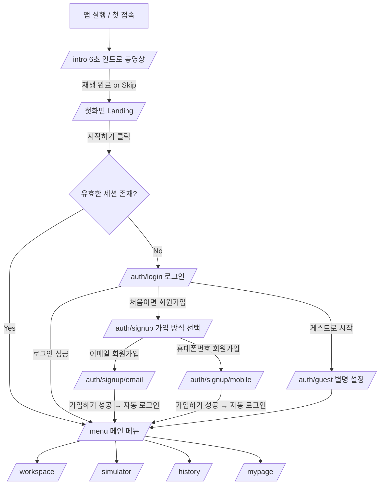

# Cursor Agent 마스터 프로젝트 개발 지시서 (FINAL v3.0)
> **프로젝트명:** removebg / RemoveBg AI  
> **목적:** 이 지시서를 Cursor (Agent / Composer 모드)에 그대로 전달하여, `BizApp Detailed App Development Plan v2.0`, `BizApp Design Doc v2.0` 및 본 문서의 **App 구성(인증·화면흐름·다국어·반응형 HUD) 확정 요구사항**을 100% 반영한 전체 코드를 자동 구현한다.  
> **작성일:** 2026-11-03  
> **우선순위 규칙:** 본 문서와 이전 문서(01~05)가 충돌하면 **본 문서(06)가 최우선**이다.

---

## 0. 절대 규칙 (Non-Negotiable Rules)

1. 모든 파일명, 변수명, 함수명, 컴포넌트명, DB 테이블/컬럼, API 경로, 상태 키, 이벤트/에러 코드는 **100% 영문(English)**.
2. 사용자에게 보이는 모든 텍스트는 **i18n 사전(ko / en / ja)** 을 통해서만 출력한다. 하드코딩 문자열 금지. **기본 언어는 한국어(ko)**.
3. 용어 통일: UI·코드·문서 어디에서도 "전화번호 로그인", "휴대폰 인증", "phone verification" 표현을 쓰지 않는다. → **"휴대폰번호" / `mobile`** 로 통일한다.
4. **SMS 인증(OTP)은 절대 구현하지 않는다.** 휴대폰번호는 이메일과 동일하게 **"ID + 비밀번호"** 로만 관리한다.
5. 모든 화면은 **Desktop / Mobile Portrait / Mobile Landscape 3개 레이아웃 프로필**을 전역에서 분리 정의하고 호출한다 (§8). 메뉴 겹침, 잘림, 가독성 저하는 **결함(Blocker)** 으로 간주한다.
6. 비밀번호는 절대 평문으로 저장·조회·표시하지 않는다 (Supabase Auth 해시 저장).

---

## 1. System Role & Execution Goal

**Role:** You are a Principal Software Architect and Lead AI Systems Engineer.  
**Task:** Build the complete codebase for **'RemoveBg AI' (removebg)**.

**Dual-Target Architecture**
- **Target A (Desktop Offline App):** Electron 33+ + React 19 renderer (shared UI) + Node.js `sharp` + Python FastAPI Sidecar (local GPU/CPU inference, $0 API cost).
- **Target B (Web/Mobile Cloud SaaS / PWA):** Next.js 15 (App Router) + Supabase (Auth/DB/pg_cron) + GCP Cloud Run GPU + Google Cloud Storage (72-Hour TTL).

Both targets share **the same UI package, i18n, auth flow, and layout system**.

---

## 2. Tech Stack & Directory Structure

### 2.1 Tech Stack
- **Frontend:** Next.js 15+ (React 19), Electron 33+, TypeScript (strict), Tailwind CSS v4, Framer Motion, Lucide Icons, HTML5 Canvas API, Zustand (client state)
- **Intro Video:** Remotion (programmatic React video rendering) → MP4/WebM
- **Image Processing (Node.js):** `sharp`, `gifuct-js`, `jszip`
- **AI Engine (Python):** Python 3.11+, PyTorch, ONNX Runtime, OpenCV, Pillow, FastAPI, Uvicorn
- **Models:** BiRefNet, BRIA RMBG 2.0, IS-Net (Anime-Seg), ViTMatte, Real-ESRGAN
- **Backend:** Supabase (PostgreSQL + Auth + `pg_cron` + Realtime), GCS (Lifecycle), GCP Cloud Run (NVIDIA L4/T4)
- **Testing:** Vitest (unit), Playwright (E2E + responsive screenshot verification)

### 2.2 Repository Structure
```text
removebgai/
├── apps/
│   ├── desktop/
│   │   ├── src/main/            # aiBridge.ts, sidecarLauncher.ts, deepLinkAuth.ts
│   │   ├── src/preload/
│   │   ├── python_sidecar/      # sidecar_server.py, model_loader.py, pipeline.py, requirements.txt
│   │   └── package.json
│   └── web/
│       ├── src/app/
│       │   ├── intro/page.tsx
│       │   ├── page.tsx                     # Landing (첫화면)
│       │   ├── auth/login/page.tsx
│       │   ├── auth/signup/page.tsx         # 가입 방식 선택 (2 buttons)
│       │   ├── auth/signup/email/page.tsx
│       │   ├── auth/signup/mobile/page.tsx
│       │   ├── auth/guest/page.tsx          # 게스트 별명 설정
│       │   ├── auth/callback/route.ts       # Google OAuth callback
│       │   ├── (app)/layout.tsx             # 로그인 후 공통 AppShell (TopBar)
│       │   ├── (app)/menu/page.tsx          # 메인 메뉴
│       │   ├── (app)/workspace/page.tsx     # 배경 제거 작업
│       │   ├── (app)/simulator/page.tsx     # 인게임 시뮬레이터
│       │   ├── (app)/history/page.tsx       # 작업 내역 / 다운로드
│       │   ├── (app)/mypage/page.tsx
│       │   └── api/
│       │       ├── auth/signup-email/route.ts
│       │       ├── auth/signup-mobile/route.ts
│       │       ├── auth/guest/route.ts
│       │       ├── profile/locale/route.ts
│       │       └── remove-bg/route.ts
│       ├── src/components/
│       │   ├── layout/   # LayoutProvider, AppShell, TopBar, HomeButton, LanguagePills, LanguageToggle
│       │   ├── auth/     # AuthCard, MobileNumberInput, PasswordField
│       │   └── studio/   # DropZone, BatchQueue, SimulatorCanvas, BrushCanvas
│       ├── src/lib/      # supabaseClient, supabaseServer, mobileNumber.ts, authService.ts, localeService.ts
│       ├── src/layout/   # layoutModes.ts, hudConfig.ts, useLayoutMode.ts
│       ├── public/intro/ # intro_landscape.mp4, intro_portrait.mp4, poster.webp
│       ├── supabase/migrations/
│       ├── gcp/          # Dockerfile, lifecycle.json
│       └── e2e/          # Playwright tests
├── packages/
│   ├── shared/           # types, i18n dictionaries (ko/en/ja)
│   └── intro-video/      # Remotion project (IntroComposition.tsx, render script)
├── package.json
└── turbo.json
```

---

## 3. 화면 흐름 (Screen Flow) — 확정



### 3.1 인트로 실행 규칙
- 앱(Electron) 실행 시 / 웹 첫 접속 시 **즉시 `/intro` 자동 재생**.
- 재생 완료(6초) 또는 [Skip] 클릭 시 `/`(첫화면)로 이동.
- 같은 세션 내에서 "처음으로 돌아가기"로 첫화면 복귀 시 인트로는 **다시 재생하지 않는다** (`sessionStorage.introPlayed = "1"`).
- 브라우저 자동재생 정책상 기본 `muted autoplay playsInline`, 우측 상단 [Sound On/Off] 토글 제공.

### 3.2 첫화면 (Landing, `/`)
- 중앙: 로고 + **[시작하기] 버튼 하나만** 표시 (다른 버튼/메뉴 없음).
- 하단 중앙: 작은 **알약(pill) 모양 언어 버튼 3개**를 가로로 나란히 배치: `한국어` | `English` | `日本語`.
  - 선택된 언어는 네온 시안 글로우 + 채움, 나머지는 외곽선 스타일.
  - 버튼 라벨은 언어와 무관하게 항상 각 언어 고유 표기로 고정.
- [시작하기] 클릭 → 세션이 유효하면 `/menu`, 없으면 `/auth/login`.

### 3.3 로그인 화면 (`/auth/login`)
글래스모피즘 카드(AuthCard) 내부 구성 (위→아래):
1. 카드 **내부 상단 오른쪽**: `HomeButton` (§5) — 첫화면으로 이동.
2. 로그인 방식 탭: `이메일` | `휴대폰번호`
   - 이메일 탭: 이메일 입력 + 비밀번호 입력
   - 휴대폰번호 탭: `MobileNumberInput` (§4.3) + 비밀번호 입력
3. **[로그인]** 버튼 (Primary)
4. 그 바로 아래 텍스트 링크: **"처음이면 회원가입"** → `/auth/signup`
5. 구분선 아래: **[Google로 계속하기]**, **[게스트로 시작]**
- 화면 상단 오른쪽(카드 밖)에는 `LanguageToggle (Ko/En/Ja)` 배치 (로그인 전 화면이므로 마이페이지/로그아웃은 없음).

### 3.4 회원가입 방식 선택 (`/auth/signup`)
- 카드 내부 상단 오른쪽 `HomeButton`.
- **버튼 2개만 표시:** [이메일 회원가입], [휴대폰번호 회원가입]. 그 외 입력창 없음.
- 하단 작은 링크: "이미 계정이 있으면 로그인" → `/auth/login`.

### 3.5 이메일 회원가입 (`/auth/signup/email`)
- 카드 내부 상단 오른쪽 `HomeButton`.
- 입력: 이메일 → 비밀번호 → 비밀번호 확인 → **[가입하기]** (비밀번호 확인 입력창 바로 아래).
- 성공 시 **자동 로그인 후 `/menu`로 즉시 이동** (이메일 확인 메일 대기 없음).

### 3.6 휴대폰번호 회원가입 (`/auth/signup/mobile`)
- 카드 내부 상단 오른쪽 `HomeButton`.
- 입력: `MobileNumberInput` → 비밀번호 → 비밀번호 확인 → **[가입하기]**.
- 성공 시 **자동 로그인 후 `/menu`로 즉시 이동**. SMS 발송 없음.

### 3.7 게스트로 시작 (`/auth/guest`)
- 카드 내부 상단 오른쪽 `HomeButton`.
- **별명(nickname) 입력 필수** (2~16자, 한/영/일/숫자/`_`/`-`), [시작하기] 클릭 시 `/menu`.
- 이후 모든 메뉴 표시명·작업 DB 기록은 이 별명 기준으로 진행.
- 현재 **활성 게스트 세션**이 사용 중인 별명은 중복 불가. 로그아웃된(비활성) 별명은 **재사용 가능**.

### 3.8 메인 메뉴 (`/menu`) 및 각 메뉴 화면
- 메뉴 카드: [배경 제거 (Workspace)] (최우선·가장 크게), [인게임 시뮬레이터], [작업 내역 / 다운로드], [마이페이지].
- 상단 인사말: 회원은 ID(이메일 또는 휴대폰번호), 게스트는 "별명 (Guest)".
- `/menu`, `/workspace`, `/simulator`, `/history`, `/mypage` 모두 공통 `TopBar` (§5.2) 사용.

### 3.9 마이페이지 (`/mypage`)
- **회원:**
  - 계정 유형 배지 (Email / Mobile / Google)
  - **ID 표시**: 이메일 또는 휴대폰번호(`+82 10 1234 5678` 형식) 또는 Google 이메일
  - **비밀번호 표시**: `••••••••` 마스킹 (보안상 원문 표시 불가. Supabase는 해시만 저장)
  - **[비밀번호 변경]**: 현재 비밀번호 → 새 비밀번호 → 새 비밀번호 확인 → [변경 저장]. 현재 비밀번호 재인증 후 `supabase.auth.updateUser({ password })`.
  - Google 계정은 비밀번호 영역 대신 "Google 계정으로 로그인 중" 안내.
  - 가입일, 최근 로그인, 선호 언어 표시.
- **게스트:** 별명, 세션 만료 예정 시각(72h) 표시. 비밀번호 영역 없음. "회원가입하면 기록을 계속 보관할 수 있어요" 안내.

---

## 4. 인증 (Authentication) 상세 명세

### 4.1 계정 유형
| account_type | 로그인 ID | 비밀번호 | 데이터 보관 |
| --- | --- | --- | --- |
| `email` | 이메일 | 사용자 설정 | 영구 보관/열람 |
| `mobile` | 휴대폰번호 (E.164) | 사용자 설정 | 영구 보관/열람 |
| `google` | Google 이메일 | 없음 (OAuth) | 영구 보관/열람 |
| `guest` | 별명 | 없음 | 72시간 후 자동 삭제 |

### 4.2 Supabase 설정 (필수)
- Auth > Providers > **Email: Enabled**, **Confirm email: OFF** (가입 즉시 로그인).
- **Phone provider는 사용하지 않는다** (SMS 비용·OTP 회피).
- **Anonymous sign-ins: Enabled** (게스트용).
- Google provider Enabled (Web redirect: `/auth/callback`, Electron: `removebgai://auth/callback` deep link).
- 회원가입은 서버 Route Handler에서 `SUPABASE_SERVICE_ROLE_KEY`로 `auth.admin.createUser({ email, password, email_confirm: true })` 실행 후, 클라이언트가 `signInWithPassword`로 즉시 로그인한다. Service Role Key는 절대 클라이언트 번들에 포함하지 않는다.

### 4.3 휴대폰번호 입력 및 정규화 (`MobileNumberInput`, `lib/mobileNumber.ts`)
- UI: **왼쪽 국가인식번호 입력창** (기본값 `+82`, 폭 고정 약 84px) + **오른쪽 휴대폰번호 입력창** (placeholder: `10 1234 5678`).
- `inputMode="tel"`, `autoComplete="tel-national"`.
- **`-`와 공백(` `)은 있어도 없어도 동일하게 처리**한다. 국가번호의 `+` 생략도 허용.
- 정규화 규칙:
```typescript
export function normalizeMobile(countryCodeRaw: string, numberRaw: string) {
  const cc = countryCodeRaw.replace(/[^\d]/g, "");          // "+82" -> "82"
  let national = numberRaw.replace(/[\s-]/g, "");          // remove spaces & hyphens
  if (!/^\d+$/.test(national) || !/^\d{1,4}$/.test(cc)) throw new Error("INVALID_MOBILE");
  if (national.startsWith("0")) national = national.slice(1); // "01012345678" -> "1012345678"
  const e164 = `+${cc}${national}`;
  if (e164.length < 9 || e164.length > 16) throw new Error("INVALID_MOBILE");
  return { countryCode: `+${cc}`, national, e164 };          // "+821012345678"
}

export function mobileToAuthEmail(e164: string) {
  return `p${e164.replace("+", "")}@phone.removebgai.local`; // internal only, never shown in UI
}

export function formatMobileForDisplay(countryCode: string, national: string) {
  return `${countryCode} ${national.replace(/^(\d{2})(\d{3,4})(\d{4})$/, "$1 $2 $3")}`;
}
```
- `010-1234-5678`, `010 1234 5678`, `01012345678`, `10 1234 5678`, `1012345678` 은 모두 `+821012345678` 로 동일 계정 처리.
- 휴대폰번호 계정은 내부적으로 `mobileToAuthEmail(e164)` 가상 이메일로 Supabase Email/Password 계정을 생성하고, 실제 번호는 `profiles.mobile_e164`에 저장한다. **UI에는 가상 이메일을 절대 노출하지 않는다.**

### 4.4 비밀번호 정책
- 8~64자, 영문 + 숫자 각 1자 이상 포함.
- 비밀번호 확인 불일치 시 [가입하기] 비활성 + 인라인 오류.
- 비밀번호 입력창에는 보기/숨기기(눈 아이콘) 토글 제공 (입력 중인 값에 한함).

### 4.5 게스트 처리
1. `/auth/guest`에서 별명 입력 → `POST /api/auth/guest` 에서 활성 별명 중복 검사.
2. `supabase.auth.signInAnonymously()` → `profiles` 행 생성 (`account_type='guest'`, `nickname`, `guest_session_active=true`, `guest_expires_at = NOW() + 72h`).
3. **로그아웃 시:** `guest_session_active=false` 로 변경 후 signOut. 이후 해당 별명과 파일은 **앱에서 더 이상 검색·조회 불가**, 별명은 즉시 **재사용 가능**.
4. DB/스토리지의 게스트 데이터는 **72시간 보관 후 pg_cron이 순차 자동 삭제** (§6).

### 4.6 세션 및 자동 진입
- Supabase 세션은 persist (Web: cookie via `@supabase/ssr`, Electron: secure storage).
- [시작하기] 클릭 시 `getUser()`로 유효성 검사 → 유효하면 `/menu`.
- 비활성 게스트(`guest_session_active=false`) 세션은 무효로 간주하여 `/auth/login`.
- `(app)` 라우트 그룹은 미들웨어로 보호. 미로그인 접근 시 `/auth/login`.

---

## 5. 공통 UI 컴포넌트

### 5.1 HomeButton (처음으로 돌아가기)
- 작은 원형 아이콘 버튼 (Lucide `Home`, 36×36px, 모바일 터치 영역 44×44px 확보).
- 바로 옆(왼쪽)에 **작고 예쁜 말풍선**: i18n `nav_go_home` ("처음으로 돌아가기" / "Back to start" / "最初に戻る").
  - 스타일: 글래스 배경, 네온 시안 1px 테두리, 12~13px 텍스트, 버튼 쪽을 향한 꼬리(tail), 부드러운 float 애니메이션.
  - 처음 사용자 안내 목적: **화면 진입 후 4초간 표시 후 페이드아웃**, 이후 hover/focus/long-press 시 다시 표시. 사용자가 한 번이라도 HomeButton을 누르면 `localStorage.homeHintSeen=1`로 저장해 자동 표시를 줄인다 (hover 표시는 유지).
  - 말풍선이 다른 요소와 겹칠 공간이 없으면(모바일 세로) 말풍선을 버튼 **아래쪽**으로 자동 배치.
- 클릭 시 `/`(첫화면)로 이동. 로그인 상태는 유지.
- **배치 위치:**
  - 로그인, 회원가입 선택, 이메일 가입, 휴대폰번호 가입, 게스트 화면: **AuthCard 박스 내부 상단 오른쪽**.
  - 메인 메뉴, 각 메뉴 화면, 마이페이지: `TopBar` 좌측 로고 옆.

### 5.2 TopBar (로그인 이후 모든 화면 공통)
- **오른쪽 상단 가로 정렬 순서 (좌→우):** `[Ko|En|Ja] [마이페이지] [로그아웃]`
  - 언어 토글은 마이페이지·로그아웃 버튼 그룹의 바로 왼쪽에 위치하며, 마이페이지 버튼과 로그아웃 버튼은 가로로 나란히 배치된다.
- 왼쪽: `HomeButton` + RemoveBg AI 로고 + 현재 화면 제목.
- `/mypage` 화면에서는 [마이페이지] 버튼을 active 상태로 표시.

### 5.3 LanguagePills (첫화면 전용)
- 하단 중앙, `한국어` `English` `日本語` 가로 3개 알약. 높이 32px(모바일 36px), 간격 8px.

### 5.4 LanguageToggle (첫화면 외 모든 화면)
- 작은 세그먼트 토글 `Ko | En | Ja` (각 세그먼트 최소 36×28px, 모바일 44×32px 터치 영역).
- 현재 언어 세그먼트 강조. 클릭 즉시 전체 UI 언어 전환 (페이지 리로드 없음).

### 5.5 언어 상태 저장 / 복원 규칙
- 기본값: `ko`.
- 로그인 전: `localStorage.locale` 저장/복원.
- **회원 (email/mobile/google):** 언어 변경 시 즉시 `profiles.preferred_locale` 업데이트 (`PATCH /api/profile/locale`, debounce 300ms) + localStorage 동기화.
  - **로그아웃 직전 상태가 DB에 저장되어 있으므로**, 다음 로그인 성공 직후 `preferred_locale`을 읽어 **자동으로 이전 언어로 전환**한다 (localStorage 값보다 DB 값 우선).
- **게스트:** 세션 중 localStorage만 사용. 재로그인 시 복원 대상 아님.

---

## 6. Database Schema & 72-Hour TTL

`supabase/migrations/20261103_init.sql`:

```sql
CREATE EXTENSION IF NOT EXISTS "pgcrypto";
CREATE EXTENSION IF NOT EXISTS "pg_cron";

-- Profiles (1:1 with auth.users)
CREATE TABLE public.profiles (
    id UUID PRIMARY KEY REFERENCES auth.users(id) ON DELETE CASCADE,
    account_type TEXT NOT NULL CHECK (account_type IN ('email', 'mobile', 'google', 'guest')),
    email TEXT,
    mobile_country_code TEXT,
    mobile_national TEXT,
    mobile_e164 TEXT,
    nickname TEXT,
    preferred_locale TEXT NOT NULL DEFAULT 'ko' CHECK (preferred_locale IN ('ko', 'en', 'ja')),
    guest_session_active BOOLEAN NOT NULL DEFAULT FALSE,
    guest_expires_at TIMESTAMPTZ,
    last_login_at TIMESTAMPTZ DEFAULT NOW(),
    created_at TIMESTAMPTZ DEFAULT NOW(),
    updated_at TIMESTAMPTZ DEFAULT NOW(),
    CONSTRAINT guest_requires_nickname CHECK (account_type <> 'guest' OR nickname IS NOT NULL)
);

CREATE UNIQUE INDEX uq_profiles_mobile ON public.profiles (mobile_e164) WHERE mobile_e164 IS NOT NULL;
CREATE UNIQUE INDEX uq_active_guest_nickname ON public.profiles (lower(nickname))
    WHERE account_type = 'guest' AND guest_session_active = TRUE;

-- Jobs
CREATE TABLE public.jobs (
    id UUID PRIMARY KEY DEFAULT gen_random_uuid(),
    user_id UUID NOT NULL REFERENCES auth.users(id) ON DELETE CASCADE,
    is_guest BOOLEAN NOT NULL DEFAULT FALSE,
    original_file_name TEXT NOT NULL,
    original_file_url TEXT,
    result_file_url TEXT,
    status TEXT NOT NULL DEFAULT 'QUEUED'
        CHECK (status IN ('QUEUED', 'PROCESSING', 'COMPLETED', 'FAILED', 'EXPIRED')),
    options JSONB DEFAULT '{"autoTrim": true, "padding": 2, "defringing": true, "outputFormat": "png"}'::jsonb,
    created_at TIMESTAMPTZ DEFAULT NOW(),
    file_expires_at TIMESTAMPTZ DEFAULT (NOW() + INTERVAL '72 hours')
);

-- RLS
ALTER TABLE public.profiles ENABLE ROW LEVEL SECURITY;
ALTER TABLE public.jobs ENABLE ROW LEVEL SECURITY;

CREATE POLICY "own_profile_select" ON public.profiles FOR SELECT USING (auth.uid() = id);
CREATE POLICY "own_profile_update" ON public.profiles FOR UPDATE USING (auth.uid() = id);

CREATE POLICY "own_jobs_active" ON public.jobs FOR ALL USING (
    auth.uid() = user_id
    AND NOT EXISTS (
        SELECT 1 FROM public.profiles p
        WHERE p.id = auth.uid() AND p.account_type = 'guest' AND p.guest_session_active = FALSE
    )
);

-- Hourly cleanup
SELECT cron.schedule('ttl-cleanup-hourly', '0 * * * *', $$
    -- 1) Member files: keep history row, expire file links after 72h
    UPDATE public.jobs
       SET original_file_url = NULL, result_file_url = NULL, status = 'EXPIRED'
     WHERE is_guest = FALSE AND file_expires_at < NOW() AND status <> 'EXPIRED';

    -- 2) Guests: delete auth user (cascades profiles + jobs) 72h after creation
    DELETE FROM auth.users u
     USING public.profiles p
     WHERE p.id = u.id AND p.account_type = 'guest' AND p.guest_expires_at < NOW();
$$);
```

- 회원(email/mobile/google)의 `profiles`와 `jobs` 이력은 **영구 보관·열람**. 이미지 파일은 저작권·용량 정책에 따라 72시간 후 삭제되고 이력에 `EXPIRED`로 표시.
- 게스트: 별명·이력·파일 모두 72시간 후 순차 자동 삭제.

### 6.1 GCS Lifecycle (`gcp/lifecycle.json`)
```json
{ "lifecycle": { "rule": [ { "action": { "type": "Delete" }, "condition": { "age": 3, "isLive": true } } ] } }
```
- 객체 경로: `users/{userId}/{jobId}/original.*`, `users/{userId}/{jobId}/result.png|webp`.

---

## 7. Intro Video (6초) — 자체 생성

`packages/intro-video` (Remotion)에서 코드로 생성·렌더링한다.

- **규격:** 6.0초, 30fps (180 frames), `intro_landscape.mp4` 1920×1080, `intro_portrait.mp4` 1080×1920, H.264, 각 2MB 이하 목표, `poster.webp`.
- **스토리보드 ('케데헌' 다크 네온 바이브):**
  - 0.0–1.0s: 옵시디언(#0B0C10) 암전 → 중앙에 네온 시안 스캔 라인이 가로로 번쩍임.
  - 1.0–2.5s: 실루엣 캐릭터 스프라이트가 체커보드 위에 등장, 흰 배경이 네온 커터 라인으로 잘려 나가며 파티클로 흩어짐 (배경 제거 은유).
  - 2.5–4.0s: 마젠타(#FF0055)·퍼플(#9D00FF) 글로우 펄스, 투명 PNG가 초원/던전 타일 위로 착지.
  - 4.0–5.5s: 로고 "RemoveBg AI" 글리치 등장 + 서브타이틀 (언어 무관 영문 "Precision AI Background Removal").
  - 5.5–6.0s: 페이드아웃 → 첫화면 배경과 동일 컬러로 자연스럽게 연결.
- 사운드: 짧은 신스 스윕(저작권 프리 자체 합성, Web Audio/Tone.js로 생성 후 믹스) — 기본 음소거.
- `npm run render:intro` 스크립트로 `apps/web/public/intro/`에 출력. Electron은 동일 파일을 번들.
- **Fallback:** MP4 로드 실패 시 동일 스토리보드를 Framer Motion 라이브 애니메이션(`IntroFallback.tsx`)으로 재생.
- `/intro` 페이지는 레이아웃 모드에 따라 landscape/portrait 영상을 선택, `object-fit: cover`.

---

## 8. 반응형 HUD / UX 시스템 (3 Layout Profiles) — 필수 점검 항목

### 8.1 전역 레이아웃 모드 판별 (`src/layout/useLayoutMode.ts`)
```typescript
export type LayoutMode = "desktop" | "mobilePortrait" | "mobileLandscape";

export function resolveLayoutMode(w: number, h: number): LayoutMode {
  const isLandscape = w > h;
  if (w >= 1024 && h >= 560) return "desktop";
  return isLandscape ? "mobileLandscape" : "mobilePortrait";
}
```
- `LayoutProvider`가 `resize`, `orientationchange`, `visualViewport.resize`, `matchMedia('(orientation: portrait)')` 를 구독하고 `requestAnimationFrame`으로 디바운스하여 **회전 즉시(≤100ms) 모드 전환**.
- 현재 모드를 `<html data-layout="desktop|mobilePortrait|mobileLandscape">` 로 노출 → Tailwind 커스텀 variant(`desktop:`, `mportrait:`, `mlandscape:`)로 스타일 분기.
- SSR 초기값은 User-Agent 힌트 기반 추정 후 hydration 시 보정 (레이아웃 깜빡임 최소화).

### 8.2 모드별 HUD 설정을 분리 정의 (`src/layout/hudConfig.ts`)
```typescript
export const hudConfig = {
  desktop: {
    topBar: { height: 64, rows: 1, fontSize: 15 },
    nav: "leftSidebar",           // 280px
    rightPanel: true,             // batch queue + 72h timer
    bottomNav: null,
    touchTarget: 36,
    authCardWidth: 440,
    menuGridCols: 4,
  },
  mobilePortrait: {
    topBar: { height: 104, rows: 2, fontSize: 14 }, // 2-row header
    nav: "bottomNav",             // 64px: [Convert] [Simulator] [Queue]
    rightPanel: false,
    bottomNav: { height: 64 },
    touchTarget: 44,
    authCardWidth: "calc(100vw - 32px)",
    menuGridCols: 1,
  },
  mobileLandscape: {
    topBar: { height: 48, rows: 1, fontSize: 13 },
    nav: "bottomNav",
    rightPanel: false,
    bottomNav: { height: 56 },
    touchTarget: 40,
    authCardWidth: 480,           // card scrolls internally if height is short
    menuGridCols: 2,
  },
} as const;
```
- 컴포넌트는 `const hud = useHud()` 로 현재 모드의 설정을 호출해 사용한다. 각 모드의 TopBar/Workspace/AuthCard는 **별도 컴포넌트 변형**(`TopBarDesktop`, `TopBarPortrait`, `TopBarLandscape`)으로 구현한다.

### 8.3 모드별 TopBar 배치
- **Desktop (1행):** `[Home+말풍선] [Logo] [화면제목] ······ [Ko|En|Ja] [마이페이지] [로그아웃]`
- **Mobile Portrait (2행 필수):**
  - 1행: `[Home] [Logo] [화면제목(말줄임)]`
  - 2행: 우측 정렬 `[Ko|En|Ja] [마이페이지] [로그아웃]`
  - 각 버튼 최소 44px 높이, 아이콘+텍스트(공간 부족 시 텍스트 유지, 아이콘 생략).
- **Mobile Landscape (1행 컴팩트):** `[Home] [Logo] ······ [Ko|En|Ja] [마이페이지 아이콘+짧은 라벨] [로그아웃 아이콘+짧은 라벨]`

### 8.4 가독성 / 겹침 방지 규칙
- 최소 폰트: 본문 14px, 보조 텍스트 12px (그 이하 금지). 버튼 라벨 최소 13px.
- 최소 터치 영역: 모바일 44×44px.
- `env(safe-area-inset-*)` 적용 (노치/홈 인디케이터), 높이는 `100dvh` 사용.
- TopBar·BottomNav는 `position: sticky/fixed` + 본문에 동일 높이 padding → 콘텐츠와 겹침 금지.
- 언어 변경 시 텍스트 길이 차이(영/일)로 줄바꿈·잘림이 생기지 않도록 `min-width: 0`, `truncate`, flex-wrap 금지 대신 정해진 행 구조 사용.
- 키보드가 올라온 모바일 상태에서도 [로그인]/[가입하기] 버튼이 가려지지 않도록 `visualViewport` 기반 스크롤 보정.

### 8.5 반드시 수행할 검증 (Playwright)
`e2e/responsive.spec.ts`에서 아래 뷰포트 × 화면(Landing, Login, Signup 선택, Email 가입, Mobile 가입, Guest, Menu, Workspace, MyPage) × 언어(ko/en/ja) 조합으로 스크린샷을 생성하고 자동 검사한다.

| 뷰포트 | 기대 모드 |
| --- | --- |
| 1440×900, 1280×800, 1024×768 | desktop |
| 390×844, 360×740, 412×915, 768×1024 | mobilePortrait |
| 844×390, 740×360, 915×412 | mobileLandscape |

자동 검사 항목:
1. TopBar 내 버튼들의 `getBoundingClientRect()` 상호 **겹침 0건**.
2. 모든 인터랙티브 요소가 뷰포트 안에 있고 텍스트 `scrollWidth <= clientWidth` (잘림 없음).
3. mobilePortrait에서 TopBar가 **2행**인지 확인.
4. 회전 시뮬레이션(390×844 → 844×390 → 390×844) 후 `data-layout` 값이 즉시 전환되는지 확인.
5. 계산된 폰트 크기 최소값 준수.
- 결과 스크린샷은 `e2e/__screenshots__/`에 저장하고, 실패 시 수정 후 재실행하여 **전부 통과할 때까지 반복**한다.

---

## 9. Core Image Conversion & 12-Step AI Pipeline (기존 v2.0 유지)

### 9.1 Input / Output
- 입력: `.jpg .jpeg .png .webp .avif .bmp .gif` (대소문자 무관)
- 제한: 정적 이미지 30MB, GIF 50MB, 1회 배치 30개 / 200MB, 4096px 초과 시 클라이언트 자동 다운스케일.
- 출력: 무손실 투명 `.png` 또는 `.webp` (선택), EXIF 제거.

### 9.2 GIF 분기
- `gifuct-js`로 프레임 수 N 판별. N=1 → 일반 처리, N>1 → Frame 0 추출 후 정적 투명 PNG/WebP.

### 9.3 12-Step Pipeline
1. Format Normalization (32-bit RGBA)
2. EXIF Rotation Correction
3. Guided Super-Resolution (≤512×512 → Real-ESRGAN 2x, 마스크 추출용)
4. AI Segmentation (BiRefNet / BRIA RMBG 2.0, 일러스트·애니·도트는 IS-Net Anime)
5. Alpha Matting (ViTMatte, 10px trimap)
6. Color Decontamination: `F_clean = clip((I - (1 - alpha) * B) / max(alpha, 1e-5), 0, 255)`
7. Bottom Shadow Removal
8. Alpha Thresholding (alpha < 5 → 0, RGB = 0)
9. Canvas Mode: Auto-Trim(+2px padding) / Original Canvas(W×H, pivot 유지)
10. In-Game Background Verification (Simulator)
11. Lossless Encoding (sharp `png({ compressionLevel: 9 })` / `webp({ lossless: true })`)
12. ZIP Archiving (jszip, 원본 파일명 유지)

### 9.4 Python Sidecar (`sidecar_server.py`) — 기준 템플릿
```python
import io
import cv2
import numpy as np
from fastapi import FastAPI, UploadFile, File, Form
from fastapi.responses import Response
from PIL import Image

app = FastAPI(title="RemoveBg AI Engine")

def apply_color_decontamination(img_rgba: np.ndarray, alpha: np.ndarray) -> np.ndarray:
    b, g, r, a = cv2.split(img_rgba)
    alpha_norm = a.astype(np.float32) / 255.0
    bg_color = np.array([255.0, 255.0, 255.0], dtype=np.float32)
    img_rgb = cv2.merge([r, g, b]).astype(np.float32)
    alpha_3d = np.dstack([alpha_norm] * 3)
    fg_clean = (img_rgb - (1.0 - alpha_3d) * bg_color) / np.maximum(alpha_3d, 1e-5)
    fg_clean = np.clip(fg_clean, 0, 255).astype(np.uint8)
    r_c, g_c, b_c = cv2.split(fg_clean)
    return cv2.merge([b_c, g_c, r_c, a])

@app.post("/remove-bg")
async def remove_background(file: UploadFile = File(...), apply_defringing: bool = Form(True)):
    contents = await file.read()
    np_img = np.array(Image.open(io.BytesIO(contents)).convert("RGB"))
    # PLACEHOLDER: replace with BiRefNet / IS-Net inference from model_loader.py
    gray = cv2.cvtColor(np_img, cv2.COLOR_RGB2GRAY)
    _, alpha_mask = cv2.threshold(gray, 240, 255, cv2.THRESH_BINARY_INV)
    alpha_mask[alpha_mask < 5] = 0
    rgba = cv2.cvtColor(np_img, cv2.COLOR_RGB2BGRA)
    rgba[:, :, 3] = alpha_mask
    if apply_defringing:
        rgba = apply_color_decontamination(rgba, alpha_mask)
    rgba[rgba[:, :, 3] == 0, :3] = 0
    _, buffer = cv2.imencode(".png", rgba)
    return Response(content=buffer.tobytes(), media_type="image/png")

if __name__ == "__main__":
    import uvicorn
    uvicorn.run(app, host="127.0.0.1", port=8000)
```
> threshold 마스크는 임시 placeholder이며, Stage 2에서 반드시 BiRefNet/IS-Net 실제 추론으로 교체한다.

### 9.5 Node.js Sharp Bridge (`aiBridge.ts`)
```typescript
import axios from "axios";
import FormData from "form-data";
import sharp from "sharp";

export async function processImagePipeline(
  inputBuffer: Buffer,
  options: { autoTrim: boolean; padding: number; defringing: boolean; outputFormat: "png" | "webp" }
) {
  const normalized = await sharp(inputBuffer, { page: 0 }).rotate().png().toBuffer();
  const form = new FormData();
  form.append("file", normalized, { filename: "input.png" });
  form.append("apply_defringing", String(options.defringing));
  const res = await axios.post("http://127.0.0.1:8000/remove-bg", form, {
    headers: form.getHeaders(), responseType: "arraybuffer",
  });
  let img = sharp(Buffer.from(res.data));
  if (options.autoTrim) {
    img = img.trim();
    if (options.padding > 0) {
      img = img.extend({ top: options.padding, bottom: options.padding, left: options.padding,
        right: options.padding, background: { r: 0, g: 0, b: 0, alpha: 0 } });
    }
  }
  return options.outputFormat === "webp"
    ? img.webp({ lossless: true }).toBuffer()
    : img.png({ compressionLevel: 9 }).toBuffer();
}
```

### 9.6 Simulator & Touch-Up Brush
- 배경 6종: `checkerboard`, `black`, `white`, `magenta`, `grass`, `dungeon`.
- 브러시: `Restore (+)`, `Erase (-)`, 크기 5~100px. 터치(Pointer Events) 지원.

---

## 10. Visual Design Tokens ('케데헌' Dark Neon)
```css
:root {
  --bg-obsidian: #0B0C10;
  --bg-surface: #12131C;
  --neon-cyan: #00F0FF;
  --vivid-magenta: #FF0055;
  --electric-purple: #9D00FF;
  --glass-bg: rgba(22, 24, 36, 0.8);
  --glass-blur: blur(12px);
  --neon-glow-cyan: 0 0 15px rgba(0, 240, 255, 0.5);
  --neon-glow-magenta: 0 0 15px rgba(255, 0, 85, 0.5);
}
```
- AuthCard: 글래스 패널 + 1px 네온 시안 테두리, radius 20px.
- Primary 버튼: 시안→퍼플 그라데이션 + 글로우, hover 시 글로우 증폭(Framer Motion).
- 말풍선: 글래스 + 시안 테두리 + 꼬리, 12~13px.

---

## 11. i18n Dictionary (`packages/shared/i18n.ts`) — 필수 키

```typescript
export const translations = {
  ko: {
    app_title: "RemoveBg AI - 초고정밀 AI 배경 제거",
    intro_skip: "건너뛰기", intro_sound_on: "소리 켜기", intro_sound_off: "소리 끄기",
    landing_start: "시작하기",
    nav_go_home: "처음으로 돌아가기",
    nav_mypage: "마이페이지", nav_logout: "로그아웃",
    auth_login_title: "로그인", auth_tab_email: "이메일", auth_tab_mobile: "휴대폰번호",
    auth_email: "이메일", auth_password: "비밀번호", auth_password_confirm: "비밀번호 확인",
    auth_mobile_country: "국가번호", auth_mobile_number: "휴대폰번호",
    auth_login_button: "로그인", auth_signup_link: "처음이면 회원가입",
    auth_google: "Google로 계속하기", auth_guest: "게스트로 시작",
    signup_title: "회원가입", signup_email: "이메일 회원가입", signup_mobile: "휴대폰번호 회원가입",
    signup_submit: "가입하기", signup_have_account: "이미 계정이 있으면 로그인",
    guest_title: "게스트로 시작", guest_nickname: "별명", guest_nickname_placeholder: "사용할 별명을 입력하세요",
    guest_start: "시작하기", guest_notice: "게스트 기록은 로그아웃 후 조회할 수 없으며 72시간 후 자동 삭제됩니다.",
    menu_title: "메인 메뉴", menu_workspace: "배경 제거", menu_simulator: "인게임 시뮬레이터",
    menu_history: "작업 내역 / 다운로드", menu_welcome: "{name}님, 환영합니다",
    mypage_title: "마이페이지", mypage_id: "아이디", mypage_password: "비밀번호",
    mypage_change_password: "비밀번호 변경", mypage_current_password: "현재 비밀번호",
    mypage_new_password: "새 비밀번호", mypage_new_password_confirm: "새 비밀번호 확인",
    mypage_save: "변경 저장", mypage_google_account: "Google 계정으로 로그인 중",
    mypage_guest_expires: "게스트 데이터 만료 예정", mypage_guest_upsell: "회원가입하면 기록을 계속 보관할 수 있어요",
    err_invalid_email: "올바른 이메일 형식이 아닙니다.", err_invalid_mobile: "올바른 휴대폰번호가 아닙니다.",
    err_password_rule: "비밀번호는 8자 이상, 영문과 숫자를 포함해야 합니다.",
    err_password_mismatch: "비밀번호가 일치하지 않습니다.", err_login_failed: "아이디 또는 비밀번호가 올바르지 않습니다.",
    err_already_registered: "이미 가입된 아이디입니다.", err_nickname_taken: "현재 사용 중인 별명입니다.",
    err_nickname_rule: "별명은 2~16자로 입력하세요.",
    dropzone_prompt: "이미지 또는 GIF 파일을 드래그하거나 클릭하세요.",
    option_auto_trim: "삭제된 공간 제거 (Auto-Trim + 2px 패딩)", option_original_canvas: "원본 캔버스 규격 유지",
    ttl_warning: "🔒 모든 파일은 보안을 위해 72시간 후 자동 파기됩니다.",
    simulator_title: "인게임 배경 시뮬레이터", history_expired: "파일 만료됨",
  },
  en: {
    app_title: "RemoveBg AI - Precision AI Background Remover",
    intro_skip: "Skip", intro_sound_on: "Sound on", intro_sound_off: "Sound off",
    landing_start: "Get Started",
    nav_go_home: "Back to start",
    nav_mypage: "My Page", nav_logout: "Log out",
    auth_login_title: "Log in", auth_tab_email: "Email", auth_tab_mobile: "Mobile",
    auth_email: "Email", auth_password: "Password", auth_password_confirm: "Confirm password",
    auth_mobile_country: "Country code", auth_mobile_number: "Mobile number",
    auth_login_button: "Log in", auth_signup_link: "New here? Sign up",
    auth_google: "Continue with Google", auth_guest: "Start as guest",
    signup_title: "Sign up", signup_email: "Sign up with email", signup_mobile: "Sign up with mobile number",
    signup_submit: "Sign up", signup_have_account: "Already have an account? Log in",
    guest_title: "Start as guest", guest_nickname: "Nickname", guest_nickname_placeholder: "Enter a nickname",
    guest_start: "Start", guest_notice: "Guest data can't be accessed after logout and is deleted after 72 hours.",
    menu_title: "Main Menu", menu_workspace: "Remove Background", menu_simulator: "In-Game Simulator",
    menu_history: "History / Downloads", menu_welcome: "Welcome, {name}",
    mypage_title: "My Page", mypage_id: "ID", mypage_password: "Password",
    mypage_change_password: "Change password", mypage_current_password: "Current password",
    mypage_new_password: "New password", mypage_new_password_confirm: "Confirm new password",
    mypage_save: "Save", mypage_google_account: "Signed in with Google",
    mypage_guest_expires: "Guest data expires at", mypage_guest_upsell: "Sign up to keep your history",
    err_invalid_email: "Invalid email address.", err_invalid_mobile: "Invalid mobile number.",
    err_password_rule: "Password must be at least 8 characters with letters and numbers.",
    err_password_mismatch: "Passwords do not match.", err_login_failed: "Incorrect ID or password.",
    err_already_registered: "This ID is already registered.", err_nickname_taken: "This nickname is currently in use.",
    err_nickname_rule: "Nickname must be 2-16 characters.",
    dropzone_prompt: "Drag & drop image or GIF files here, or click to browse.",
    option_auto_trim: "Auto-Trim Blank Space (Tight Box + 2px Padding)", option_original_canvas: "Keep Original Canvas Size & Pivot",
    ttl_warning: "🔒 All files are automatically deleted after 72 hours.",
    simulator_title: "In-Game Background Simulator", history_expired: "File expired",
  },
  ja: {
    app_title: "RemoveBg AI - 超高精度 AI 背景削除",
    intro_skip: "スキップ", intro_sound_on: "サウンドオン", intro_sound_off: "サウンドオフ",
    landing_start: "はじめる",
    nav_go_home: "最初に戻る",
    nav_mypage: "マイページ", nav_logout: "ログアウト",
    auth_login_title: "ログイン", auth_tab_email: "メール", auth_tab_mobile: "携帯番号",
    auth_email: "メールアドレス", auth_password: "パスワード", auth_password_confirm: "パスワード（確認）",
    auth_mobile_country: "国番号", auth_mobile_number: "携帯電話番号",
    auth_login_button: "ログイン", auth_signup_link: "初めての方は会員登録",
    auth_google: "Googleで続行", auth_guest: "ゲストではじめる",
    signup_title: "会員登録", signup_email: "メールで登録", signup_mobile: "携帯番号で登録",
    signup_submit: "登録する", signup_have_account: "アカウントをお持ちの方はログイン",
    guest_title: "ゲストではじめる", guest_nickname: "ニックネーム", guest_nickname_placeholder: "ニックネームを入力",
    guest_start: "はじめる", guest_notice: "ゲストの記録はログアウト後に閲覧できず、72時間後に自動削除されます。",
    menu_title: "メインメニュー", menu_workspace: "背景削除", menu_simulator: "インゲームシミュレーター",
    menu_history: "作業履歴 / ダウンロード", menu_welcome: "{name}さん、ようこそ",
    mypage_title: "マイページ", mypage_id: "ID", mypage_password: "パスワード",
    mypage_change_password: "パスワード変更", mypage_current_password: "現在のパスワード",
    mypage_new_password: "新しいパスワード", mypage_new_password_confirm: "新しいパスワード（確認）",
    mypage_save: "保存", mypage_google_account: "Googleアカウントでログイン中",
    mypage_guest_expires: "ゲストデータの有効期限", mypage_guest_upsell: "会員登録すると履歴を保存できます",
    err_invalid_email: "メールアドレスの形式が正しくありません。", err_invalid_mobile: "携帯電話番号が正しくありません。",
    err_password_rule: "パスワードは8文字以上で、英字と数字を含めてください。",
    err_password_mismatch: "パスワードが一致しません。", err_login_failed: "IDまたはパスワードが正しくありません。",
    err_already_registered: "既に登録されているIDです。", err_nickname_taken: "このニックネームは現在使用中です。",
    err_nickname_rule: "ニックネームは2〜16文字で入力してください。",
    dropzone_prompt: "画像またはGIFファイルをドラッグするかクリックしてください。",
    option_auto_trim: "余白自動カット (Auto-Trim + 2px パディング)", option_original_canvas: "元のキャンバスサイズを維持",
    ttl_warning: "🔒 すべてのファイルは72時間後に自動削除されます。",
    simulator_title: "インゲーム背景シミュレーター", history_expired: "ファイル期限切れ",
  },
} as const;
```
- 언어 버튼 고정 라벨: Landing `한국어 / English / 日本語`, Toggle `Ko / En / Ja` (번역하지 않음).
- `ko` 키 집합을 기준 타입으로 삼아 `en`, `ja`에 누락 키가 있으면 **타입 에러**가 나도록 구성.

---

## 12. Step-by-Step Execution Plan

1. **Stage 1 — Monorepo Setup:** Turborepo, TypeScript strict, Tailwind v4, 공통 패키지, ESLint, Vitest, Playwright 설치.
2. **Stage 2 — Python Sidecar:** BiRefNet/IS-Net 로더, ViTMatte, Color Decontamination, Thresholding.
3. **Stage 3 — Node Pipeline:** GIF Frame 0, EXIF, Auto-Trim + 2px padding, PNG/WebP 무손실, ZIP.
4. **Stage 4 — Supabase & GCP:** §6 마이그레이션, RLS, pg_cron, Auth 설정(§4.2), Cloud Run Dockerfile, GCS lifecycle.
5. **Stage 5 — Layout System:** `LayoutProvider`, `useLayoutMode`, `hudConfig`, 모드별 TopBar 3종, BottomNav, Tailwind variants.
6. **Stage 6 — Intro & Landing:** Remotion 6초 영상 렌더링, `/intro` 재생/Skip/Sound, Landing(시작하기 + 언어 알약).
7. **Stage 7 — Auth Flow:** Login(이메일/휴대폰번호 탭), Signup 선택, Email/Mobile 가입(자동 로그인 → /menu), Google, Guest 별명, HomeButton+말풍선, 세션 자동 진입, 미들웨어 보호.
8. **Stage 8 — i18n & Locale Persistence:** 사전 3종, LanguagePills/Toggle, `preferred_locale` 저장·로그인 시 복원.
9. **Stage 9 — App Screens:** Menu, Workspace(DropZone/Queue/72h Timer), Simulator, Touch-Up Brush, History(EXPIRED 표시), MyPage(ID 표시, 비밀번호 마스킹·변경).
10. **Stage 10 — Verification:**
    - Unit: `normalizeMobile` (하이픈/공백/선행 0/국가번호 `+` 유무), 비밀번호 규칙, 언어 복원.
    - E2E: 인트로 → 첫화면 → 로그인 → 메뉴 / 가입 2종 자동 로그인 / 게스트 로그아웃 후 별명 재사용 / 회원 언어 복원 / HomeButton 전 화면 동작.
    - Responsive: §8.5 전 항목 통과.
    - Electron `.exe`/`.dmg` 빌드 및 Web 배포 확인, 배치 처리 메모리 누수 없음.

---

## 13. Acceptance Checklist (완료 기준)

- [ ] 앱 실행 즉시 6초 인트로 재생, Skip/Sound 동작, 종료 후 첫화면 이동
- [ ] 첫화면: [시작하기] 하나 + 하단 `한국어 | English | 日本語` 알약 버튼
- [ ] 첫화면 외 모든 화면: `Ko|En|Ja` 토글이 `[Ko|En|Ja] [마이페이지] [로그아웃]` 순서로 상단 오른쪽에 위치 (로그인 전 화면은 토글만)
- [ ] 기본 언어 한국어, 회원 재로그인 시 직전 언어 자동 복원
- [ ] 세션 존재 시 [시작하기] → 메인 메뉴 직행
- [ ] 로그인 화면: [로그인] 아래 "처음이면 회원가입" 링크
- [ ] 로그인/가입/게스트 카드 내부 상단 오른쪽 HomeButton + "처음으로 돌아가기" 말풍선
- [ ] 메인 메뉴, 각 메뉴, 마이페이지에도 HomeButton 존재
- [ ] 회원가입 선택 화면은 버튼 2개만
- [ ] 이메일/휴대폰번호 가입 → [가입하기] → 자동 로그인 → 메인 메뉴
- [ ] 휴대폰번호: 국가번호(+82 기본) + 번호(placeholder `10 1234 5678`), `-`/공백 무관, SMS 없음
- [ ] "전화번호" 표기 0건 (전부 "휴대폰번호")
- [ ] 게스트 별명 필수, 로그아웃 후 조회 불가 및 별명 재사용 가능, 72시간 후 자동 삭제
- [ ] 마이페이지: ID 표시, 비밀번호 마스킹 + 변경 가능
- [ ] 회원 계정/이력 영구 보관
- [ ] Desktop / Mobile Portrait / Mobile Landscape HUD 분리 정의 및 회전 즉시 전환
- [ ] Mobile Portrait 상단 메뉴 2행, 겹침·잘림 0건, 최소 폰트/터치 영역 준수 (Playwright 통과)
